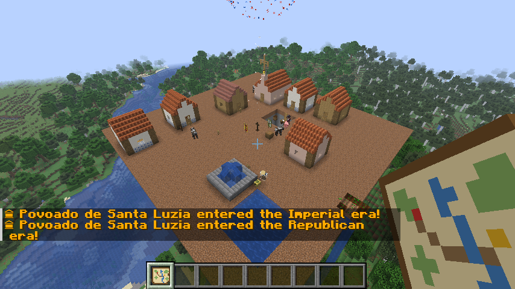
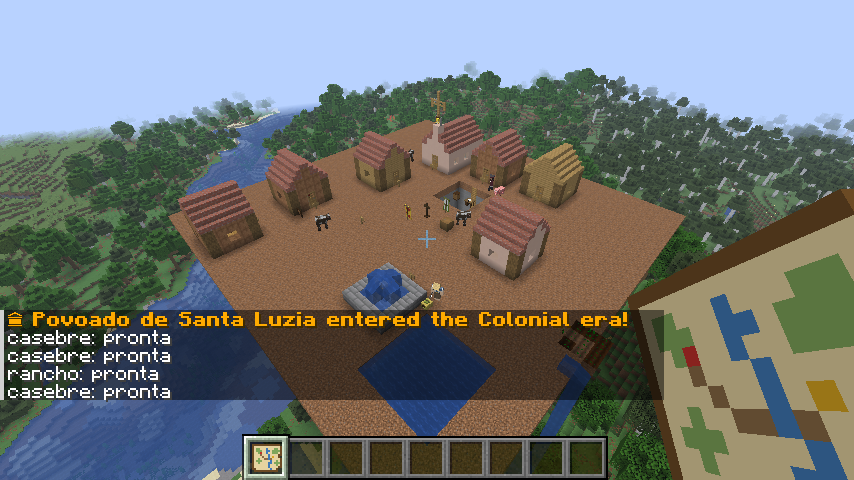
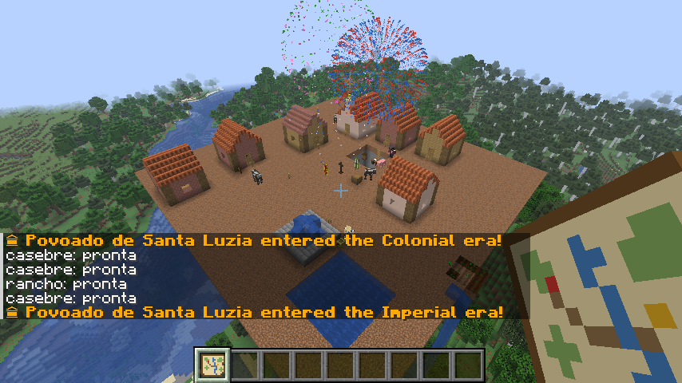
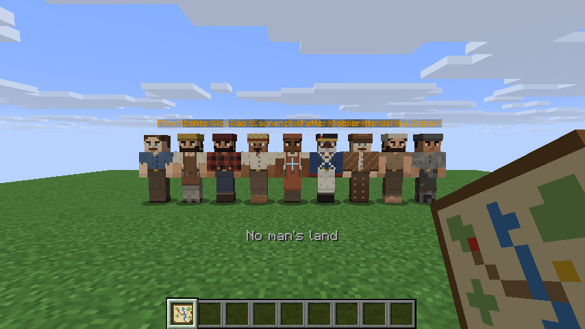
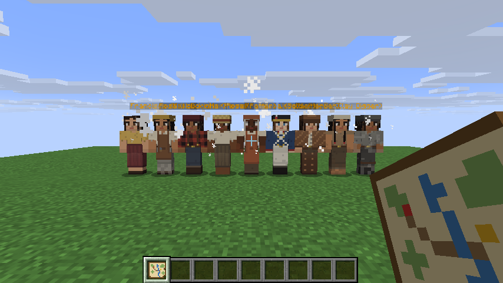
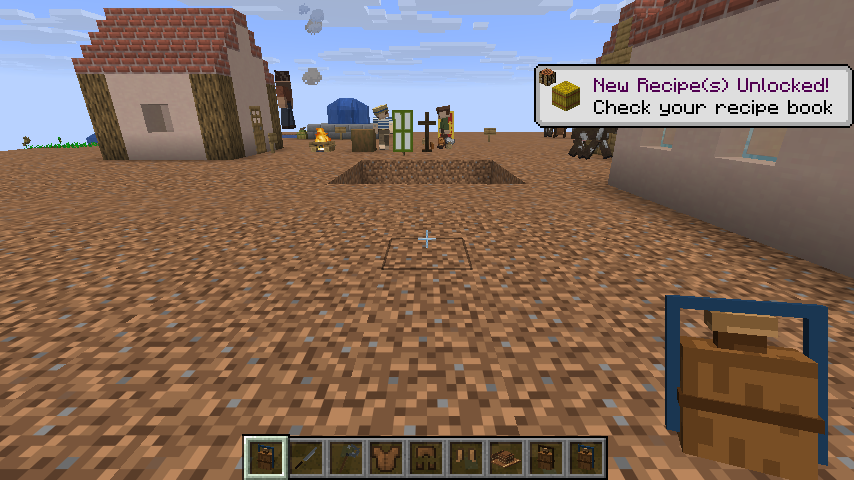
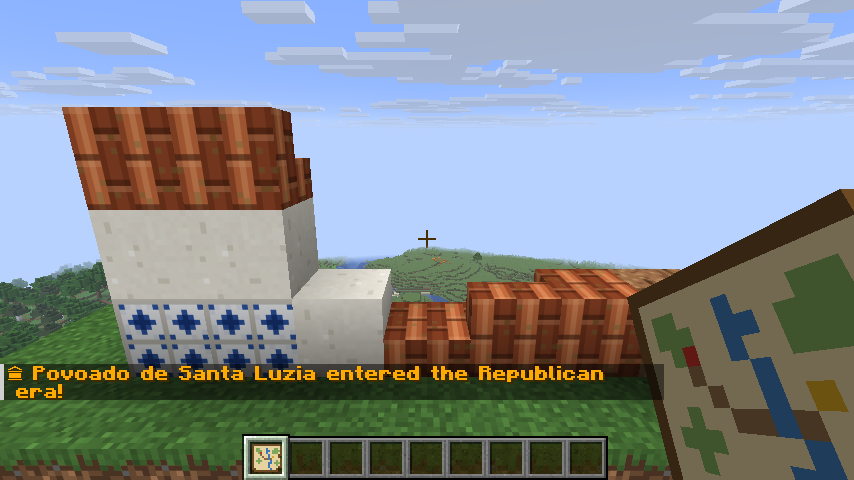

<h1 align="center">Arraial</h1>

<b>Vilas coloniais brasileiras que se constroem e se governam sozinhas.</b> 
<i>Brazilian colonial villages that build and run themselves.</i> 
Fabric · Minecraft 26.3 · <a href="#english">English below</a>

## Português

Funde um arraial com o **Cruzeiro**, contrate um pedreiro e veja o povoado crescer sozinho: os moradores constroem casas, plantam, criam, comerciam, fazem festa, votam, brigam por terra e atravessam três eras de arquitetura, do Povoado de taipa até a Cidade caiada.

### O que tem
- **16 ofícios** com posto de trabalho próprio: pedreiro, lenhador, roceiro, oleiro, barreiro, cavouqueiro, pastor (vaqueiro), pescador, caçador, farinheiro, feirante, tropeiro, boticário, soldado, engenheiro e relações públicas.
- **Obras** escolhidas no Livro de Projetos e erguidas bloco a bloco com o material do Armazém. O prefeito pede obras sozinho.
- **Estágios:** Povoado → Arraial → Vila → Vila próspera → Cidade.
- **Economia:** réis, banca de feira com preço por oferta e procura, mascates, encomendas, tropeiros entre vilas, estradas batidas e contratos.
- **Calendário e festas:** São João com fogueira e quadrilha, padroeiro, Feira Grande e tradições de cada vila.
- **Crises:** seca, enchente, praga, salteadores, epidemia e incêndio.
- **Política:** conselho por grupos, propostas, votação, impostos, corrupção, protestos e coronelismo hereditário.
- **Mundo vivo:** vilas vizinhas nascem e crescem sozinhas, migram, comerciam, entram em guerra e viram ruínas ocupadas por bandidos.
- **Território e diplomacia:** fronteiras por chunk, Marco de Fronteira, disputas, guerra e paz com tributo. Na **Chancelaria** (Escrivaninha) você propõe tratados, exige tributo e declara embargo. Tem também o **Mapa da Região**.
- **Cultura e vida pessoal:** bandeiras e costumes por vila, personalidade, amizades, rivalidades, favores, casamentos, filhos e herança.
- **Eras:** Colonial (taipa), Imperial (tijolo e telha), Republicana (cal e azulejo), com reforma das casas e das ruas, Capela e Chafariz.
- **Itens:** facão, peixeira, foice, couro de vaqueiro, cantil, comidas típicas (farinha, beiju, paçoca, rapadura, pé-de-moleque, quentão) e blocos coloniais.
- **Guia do Arraial:** manual de 49 páginas dentro do jogo, com sumário clicável.
- Compatível com o **JEI** (opcional): receitas e páginas de informação.

### Como começar
1. Faça um **Cruzeiro** (5 toras de carvalho escuro em cruz) e coloque num lugar plano. Você ganha o Guia.
2. Faça um **Armazém** (tábuas e baú), guarde comida e ponha camas.
3. Faça um **Contrato de Pedreiro** (papel, esmeralda e tijolo), um **Marco da Obra** e um **Livro de Projetos**.
4. Leia o Guia: o capítulo *Primeiros dias* traz a lista do começo.

### Instalação
- Fabric Loader 0.20.1 ou mais novo, **Fabric API** e Java 25.
- Opcional: JEI.
- Coloque o `.jar` na pasta `mods`. O mod precisa estar no servidor e no cliente.

## Imagens

| | |
|---|---|
|  |  |
|  |  |
|  |  |
|  |  |

## English

Found an arraial with the **Cruzeiro**, hire a builder and watch the settlement grow on its own. Its villagers build houses, farm, herd, trade, hold festas, vote, quarrel over land, and pass through three eras of architecture, from a mud-hut Povoado to a whitewashed Cidade.

### Features
- **16 trades**, each with its own workstation.
- **Construction projects** built block by block from the storehouse. The mayor orders works on their own.
- **Stages:** Povoado → Arraial → Vila → Prosperous Vila → Cidade.
- **Economy:** réis, a market stall with supply-and-demand prices, peddlers, orders, muleteers between villages, beaten roads and contracts.
- **Calendar and festas:** Saint John, the patron saint, the Great Fair and each village's traditions.
- **Crises:** drought, flood, pests, highwaymen, epidemics and fire.
- **Politics:** a council of interest groups, proposals, votes, taxes, corruption, protests and hereditary coronéis.
- **A living world:** neighbouring villages grow, migrate, trade, go to war and fall to ruin, where bandits move in.
- **Territory and diplomacy:** chunk borders, disputes, war and peace with tribute. At the **Chancery** you propose treaties, demand tribute and declare embargoes. There is also a **Regional Map**.
- **Culture and personal life:** flags and customs, personalities, friendships, favours, weddings, children and inheritance.
- **Eras:** Colonial, Imperial and Republican, with houses and streets reformed in each style.
- **Items:** machete, peixeira, sickle, vaqueiro leather, flask, Brazilian foods and colonial blocks.
- **In-game guide:** a 49-page manual with clickable contents.
- Optional **JEI** support.

### Install
- Fabric Loader 0.20.1+, **Fabric API** and Java 25.
- Optional: JEI.
- Required on both server and client.

---
© 2026 Guilherme Goes. Todos os direitos reservados / All rights reserved.
