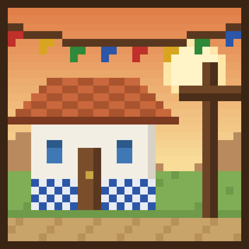
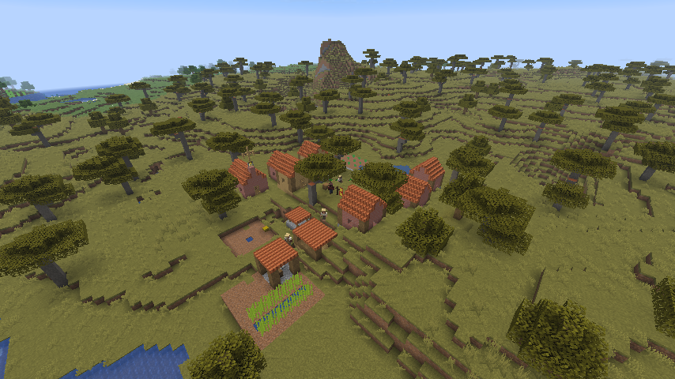
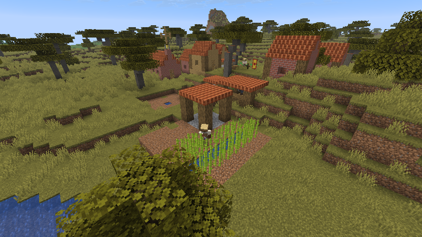
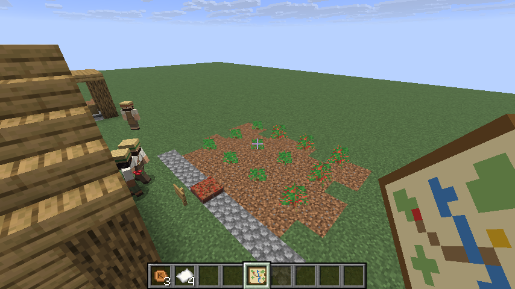
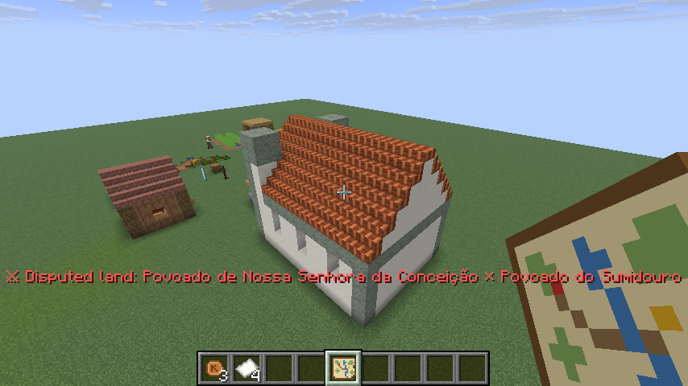
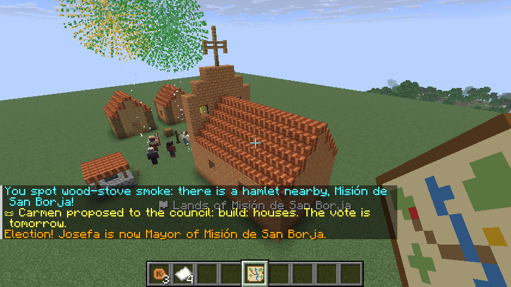
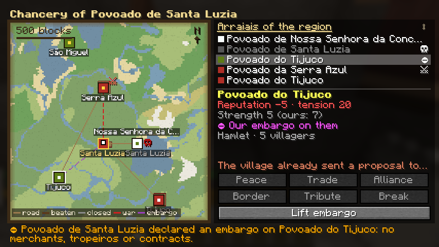
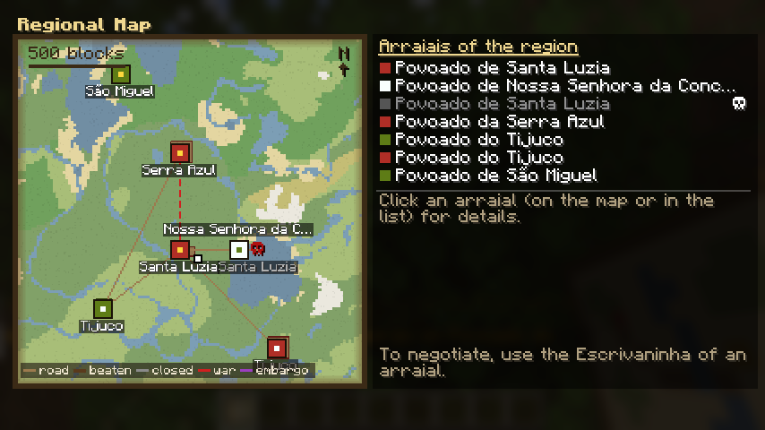
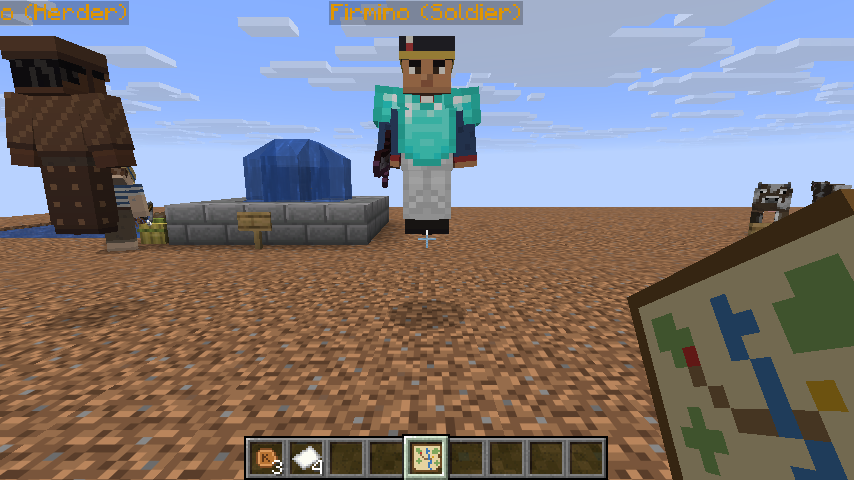
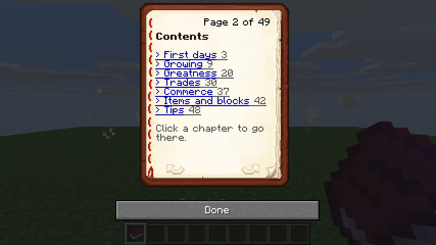

<h1 align="center">Arraial</h1>

<b>Vilas coloniais brasileiras que se constroem e se governam sozinhas.</b> 
<i>Brazilian colonial villages that build and run themselves.</i> 
Fabric · Minecraft 26.3 · <a href="https://arraial.dantas-dev.com">Wiki</a> · <a href="https://www.curseforge.com/minecraft/mc-mods/arraial">CurseForge</a> · <a href="https://dantas-dev.com/pt/blog">Devblog</a> · <a href="https://github.com/Dants0/arraial/issues">Bugs e sugestões</a> · <a href="#english">English below</a>

## Português

Funde um arraial com o **Cruzeiro**, contrate um pedreiro e veja o povoado crescer sozinho: os moradores constroem casas, plantam, criam, comerciam, fazem festa, votam, brigam por terra e atravessam três eras de arquitetura, do Povoado de taipa até a Cidade caiada.

### O que tem
- **23 ofícios** com posto de trabalho próprio: pedreiro, lenhador, roceiro, oleiro, barreiro, cavouqueiro, pastor (vaqueiro), pescador, caçador, farinheiro, feirante, tropeiro, boticário, soldado, engenheiro, relações públicas, mestre de engenho, cafeicultor, entalhador, barqueiro, estivador, moleiro e ferroviário.
- **Obras** escolhidas no Livro de Projetos e erguidas bloco a bloco com o material do Armazém. O prefeito pede obras sozinho.
- **Estágios:** Povoado → Arraial → Vila → Vila próspera → Cidade.
- **Economia:** réis, banca de feira com preço por oferta e procura, mascates, encomendas, tropeiros entre vilas, estradas batidas e contratos.
- **Calendário e festas:** São João com fogueira e quadrilha, padroeiro, Feira Grande e tradições de cada vila.
- **Crises:** seca, enchente, praga, salteadores, epidemia e incêndio.
- **Política:** conselho por grupos, propostas, votação, impostos, corrupção, protestos e coronelismo hereditário.
- **Mundo vivo:** caravanas de colonos chegam e fundam povoados na sua frente; as vilas vizinhas crescem sozinhas, migram, comerciam, entram em guerra e viram ruínas ocupadas por bandidos.
- **Território e diplomacia:** fronteiras por chunk, Marco de Fronteira, disputas, guerra e paz com tributo. Na **Chancelaria** (Escrivaninha) você propõe tratados, exige tributo e declara embargo. Tem também o **Mapa da Região**.
- **Cultura e vida pessoal:** bandeiras e costumes por vila, personalidade, amizades, rivalidades, favores, casamentos, filhos e herança.
- **Eras:** Colonial (taipa), Imperial (tijolo e telha), Republicana (cal e azulejo), com reforma das casas e das ruas, Capela e Chafariz.
- **Rios, portos e caminhos:** trapiche e canoa entre vilas ribeirinhas; porto no litoral com navio mercante (sal, ferro e chita); moinho d'água e monjolo; pontes de verdade e estradas para as vilas vizinhas; e, na era Republicana, a estação com o trem.
- **Fazendas:** engenho de cana (açúcar e rapadura), cafezal (café torrado e cafezinho), queijo coalho e charque do curral.
- **Barroco:** pedra-sabão, talha dourada, entalhador e a Igreja Matriz; vilas mineradoras ganham casas brancas sobre pedra-sabão.
- **Missões espanholas:** parte das vilas vizinhas são missões, com nomes, bandeira, adobe e igreja com espadanha próprios, e uma fronteira mais tensa.
- **Fauna brasileira:** capivara, tamanduá-bandeira, jacaré, onça-pintada e arara (vermelha, canindé e azul) nos biomas quentes. A onça caça bichos do curral e o jacaré espreita na margem.
- **Compatível com armaduras de outros mods:** os soldados vestem a melhor armadura e arma que houver no Armazém, de qualquer mod.
- **Itens:** facão, peixeira, foice, couro de vaqueiro, cantil, comidas típicas (farinha, beiju, paçoca, rapadura, pé-de-moleque, quentão) e blocos coloniais.
- **Guia do Arraial:** manual de 56 páginas dentro do jogo, com sumário clicável.
- **Integrações (todas opcionais):**
  - **JEI** e **REI**: receitas e páginas de informação.
  - **Jade**: ofício, vila, família e humor dos moradores; estágio, satisfação e prefeito no Cruzeiro.
  - **Xaero's Minimap**: as vilas que você conhece viram waypoints na cor da bandeira.
  - **Mod Menu**: tela de configuração. Sem ele, edite `config/arraial.json`.
  - **Farmer's Delight Refabricated**: baião de dois, moqueca e vaca atolada na panela; a peixeira serve de faca.
  - **Terralith**: todos os biomas reconhecidos no mapa e na cultura das vilas.

### Devblog
A criação do Arraial (sistemas, testes, bastidores) está sendo documentada no devblog: **[dantas-dev.com/pt/blog](https://dantas-dev.com/pt/blog)**.

### Como começar
1. Faça um **Cruzeiro** (5 toras de qualquer madeira em cruz) e coloque num lugar plano. Você ganha o Guia.
2. Faça um **Armazém** (tábuas e baú), guarde comida e ponha camas.
3. Faça um **Contrato de Pedreiro** (papel, esmeralda e tijolo), um **Marco da Obra** e um **Livro de Projetos**.
4. Leia o Guia: o capítulo *Primeiros dias* traz a lista do começo.

### Instalação
- Fabric Loader 0.20.1 ou mais novo, **Fabric API** e Java 25.
- Opcionais: JEI ou REI, Jade, Xaero's Minimap, Mod Menu, Farmer's Delight Refabricated, Terralith.
- Coloque o `.jar` na pasta `mods`. O mod precisa estar no servidor e no cliente.

## Imagens

| | |
|---|---|
|  |  |
|  |  |
|  |  |
|  |  |

## English

Found an arraial with the **Cruzeiro**, hire a builder and watch the settlement grow on its own. Its villagers build houses, farm, herd, trade, hold festas, vote, quarrel over land, and pass through three eras of architecture, from a mud-hut Povoado to a whitewashed Cidade.

### Features
- **23 trades**, each with its own workstation.
- **Construction projects** built block by block from the storehouse. The mayor orders works on their own.
- **Stages:** Povoado → Arraial → Vila → Prosperous Vila → Cidade.
- **Economy:** réis, a market stall with supply-and-demand prices, peddlers, orders, muleteers between villages, beaten roads and contracts.
- **Calendar and festas:** Saint John, the patron saint, the Great Fair and each village's traditions.
- **Crises:** drought, flood, pests, highwaymen, epidemics and fire.
- **Politics:** a council of interest groups, proposals, votes, taxes, corruption, protests and hereditary coronéis.
- **A living world:** caravans of settlers arrive and found hamlets before your eyes; neighbouring villages grow, migrate, trade, go to war and fall to ruin, where bandits move in.
- **Territory and diplomacy:** chunk borders, disputes, war and peace with tribute. At the **Chancery** you propose treaties, demand tribute and declare embargoes. There is also a **Regional Map**.
- **Culture and personal life:** flags and customs, personalities, friendships, favours, weddings, children and inheritance.
- **Eras:** Colonial, Imperial and Republican, with houses and streets reformed in each style.
- **Rivers, ports and roads:** wharves and canoes between riverside villages; a coastal port with a merchant ship (salt, iron and chita cloth); water mills and the monjolo; real bridges and roads to neighbouring villages; and, in the Republican era, the railway station and its train.
- **Fazendas:** sugar mills (sugar, rapadura), coffee plantations (roasted coffee, cafezinho), queijo coalho and charque.
- **Baroque:** soapstone, gilded carving, the carver and the Mother Church; mining towns get white houses on soapstone.
- **Spanish missions:** some neighbours are missions, with their own names, flag, adobe and bell-gable church, and a tenser frontier.
- **Brazilian wildlife:** capybara, giant anteater, caiman, jaguar and macaw (red, blue-and-yellow, hyacinth) in warm biomes. The jaguar hunts corral animals and the caiman lurks at the riverbank.
- **Armour from other mods:** soldiers wear the best armour and weapon in the storehouse, from any mod.
- **Items:** machete, peixeira, sickle, vaqueiro leather, flask, Brazilian foods and colonial blocks.
- **In-game guide:** a 56-page manual with clickable contents.
- **Integrations (all optional):**
  - **JEI** and **REI**: recipes and information pages.
  - **Jade**: trade, village, family and mood of villagers; stage, satisfaction and mayor on the Cruzeiro.
  - **Xaero's Minimap**: the villages you know become waypoints in their flag colour.
  - **Mod Menu**: a settings screen. Without it, edit `config/arraial.json`.
  - **Farmer's Delight Refabricated**: baião de dois, moqueca and vaca atolada in the cooking pot; the peixeira works as a knife.
  - **Terralith**: every biome recognised by the map and village cultures.

### Devblog
The making of Arraial (systems, tests, behind the scenes) is documented on the devblog (in Portuguese and English): **[dantas-dev.com/pt/blog](https://dantas-dev.com/pt/blog)**, **[dantas-dev.com/en/blog](https://dantas-dev.com/en/blog)**

### Install
- Fabric Loader 0.20.1+, **Fabric API** and Java 25.
- Optional: JEI or REI, Jade, Xaero's Minimap, Mod Menu, Farmer's Delight Refabricated, Terralith.
- Required on both server and client.

## Licença / License
O código é público para leitura e contribuição, mas **todos os direitos são reservados**: veja a [LICENSE](LICENSE).
Pode: jogar, usar em servidores, incluir em modpacks (baixando da página oficial), fazer vídeos e lives (inclusive monetizados) e contribuir.
Não pode sem permissão: republicar o mod em outros sites, vender, ou publicar versões modificadas.

The source is public to read and contribute to, but **all rights are reserved**: see the [LICENSE](LICENSE).
You may play it, use it on servers, include it in modpacks (downloaded from an official page), make videos and streams (monetized too) and contribute.
You may not, without permission: reupload it elsewhere, sell it, or publish modified versions.

Páginas oficiais / Official pages: [Wiki](https://arraial.dantas-dev.com) · [GitHub](https://github.com/Dants0/arraial), [Devblog](https://dantas-dev.com/pt/blog) · [CurseForge](https://www.curseforge.com/minecraft/mc-mods/arraial) · Modrinth (em análise / in review).

Contribuições / Contributing: [CONTRIBUTING.md](CONTRIBUTING.md).

---
© 2026 Guilherme Goes. Arraial não é um produto oficial do Minecraft nem é associado à Mojang ou à Microsoft. / Not an official Minecraft product; not associated with Mojang or Microsoft.
