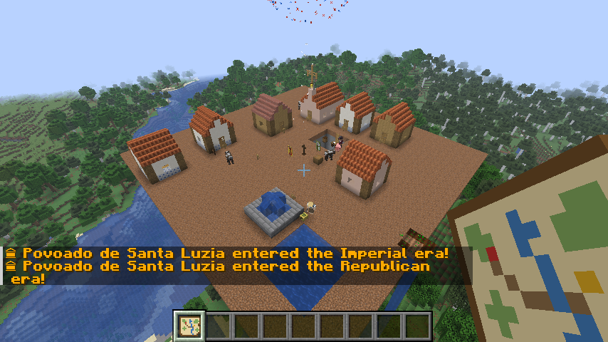
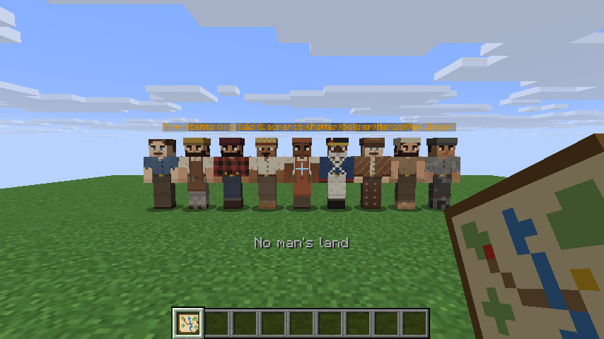
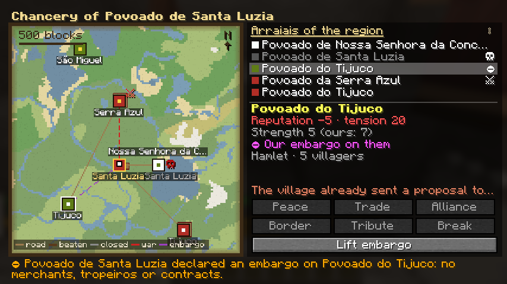

Título: Fiz um mod de Minecraft com vilas do Brasil colonial que se constroem, comerciam, votam e entram em guerra sozinhas

---

Nas últimas semanas eu construí o **Arraial**, um mod para Minecraft (Fabric, versão 26.3) inspirado nos povoados do Brasil colonial. A ideia é simples de explicar e deu bastante trabalho de fazer: você finca um Cruzeiro, contrata um pedreiro, e o povoado cresce **sozinho**, de umas casas de taipa até uma Cidade caiada com capela, chafariz, conselho municipal e vizinhos com quem comerciar, ou guerrear.



Neste post eu conto o que o mod faz e, principalmente, **como** algumas partes foram construídas, porque foi aí que eu mais aprendi.

## O que o mod faz

- **16 ofícios**, cada um com seu posto de trabalho: pedreiro, lenhador, roceiro, oleiro, barreiro, cavouqueiro, vaqueiro, pescador, caçador, farinheiro, feirante, tropeiro, boticário, soldado, engenheiro e relações públicas.
- **Obras de verdade**: o projeto é escolhido num livro e os pedreiros erguem a construção bloco a bloco, tirando material do armazém. O prefeito decide sozinho o que construir conforme o que falta.
- **Economia**: moeda (réis), feira com preço por oferta e procura, mascates, encomendas, tropeiros entre vilas, estradas que ficam "batidas" com o uso e contratos de fornecimento.
- **Política**: conselho com representantes de cada grupo (lavoura, ofícios, ordem, comércio e povo), propostas, votação, impostos, corrupção, protestos e coronelismo hereditário.
- **Festas e crises**: São João com fogueira e quadrilha, padroeiro, Feira Grande; seca, enchente, praga, salteadores, epidemia e incêndio.
- **Território e diplomacia**: fronteiras por chunk, disputas, escaramuças, paz com tributo, e uma tela de diplomacia em que você propõe tratados, exige tributo ou declara embargo.
- **Três eras de arquitetura**: Colonial (taipa) → Imperial (tijolo e telha) → Republicana (cal e azulejo). Os pedreiros reformam as casas e as ruas a cada era.
- **Vida pessoal**: personalidade, amizades, rivalidades, favores, casamentos, filhos que herdam a aparência dos pais e herança do comando da vila.



## Como algumas partes funcionam por dentro

### 1. Simular vilas que ninguém está olhando

O Minecraft só processa os pedaços do mundo (chunks) que estão perto de algum jogador. Uma vila a 600 blocos de distância simplesmente não existe para o jogo naquele momento, mas eu queria que ela continuasse vivendo: produzindo, passando fome, crescendo e brigando com os vizinhos.

A solução foi manter um **registro regional** à parte (um JSON salvo junto com o mundo) com o estado resumido de cada vila: população, estoque, tesouro, ofícios, reputação com as outras, tratados, rotas. Uma vez por dia de jogo, as vilas descarregadas são simuladas de forma agregada: produção por ofício, consumo, migração para o vizinho com mais comida, crises, comércio e guerra. Quando o jogador chega perto e a vila carrega, as diferenças são aplicadas de verdade: moradores somem ou chegam, o armazém muda e a crônica da vila ganha as notícias do que aconteceu na ausência.

Um detalhe que eu gostei: para saber o bioma de um lugar longe **sem carregar o chunk**, dá para perguntar direto ao gerador de mundo:

```java
var fonte = level.getChunkSource().getGenerator().getBiomeSource();
var bioma = fonte.createCachingResolver(level.getChunkSource().randomState())
        .getNoiseBiome(QuartPos.fromBlock(x), QuartPos.fromBlock(y), QuartPos.fromBlock(z));
```

É assim que cada vila ganha uma cultura (sertão, mata, serra, ribeirinha...) e que o **Mapa da Região** desenha os biomas de uma área de mais de 1.700 blocos instantaneamente.



### 2. Texturas e skins geradas por código

Quase toda a arte do mod é gerada por scripts: as texturas dos blocos (taipa, telha capa-e-canal, cal, azulejo), o couro do vaqueiro, o ícone e as **216 skins** dos moradores (18 ofícios × 2 sexos × 6 aparências).

O gerador de skins é um script em Node sem dependências: escrevi um codificador de PNG mínimo (cabeçalho, CRC32 e `zlib.deflateSync`, que já vem no Node) e desenho direto no layout UV da skin do Minecraft. Cada face de cada parte do corpo tem a sua luz (frente, lados, costas, topo); as sombras puxam para um roxo frio e as luzes para um amarelo quente, um truque clássico de pixel art. Por cima entram a trama do tecido, a gola, os botões, o cinto com fivela, e a "marca" de cada ofício: chapéu de palha do roceiro, gibão lavrado do vaqueiro, talabartes cruzados do soldado, xadrez do lenhador, óculos do boticário.

A vantagem de gerar por código é que mudar o estilo de 216 skins é editar uma função e rodar de novo.

### 3. Um teste que joga o jogo sozinho

O que mais me ajudou foi um **roteiro de teste automático** que roda dentro do cliente do Minecraft. Ligado por uma variável de ambiente, ele abre um mundo de teste, executa comandos no servidor integrado, clica em blocos e em moradores, abre telas, tira screenshots e escreve verificações no log: "a foice colheu 9 de 9", "a criança nasceu com escala 0,55", "o embargo fechou a estrada no servidor".

Ele achou bugs que nenhum teste de servidor pegaria:

- **Modelos de bloco usando texturas de item** são rejeitados pelo jogo nesta versão, e os blocos apareciam como o cubo roxo e preto de textura faltando.
- **No modo de um jogador, cliente e servidor rodam no mesmo processo**, e eu tinha conjuntos estáticos compartilhados entre os dois. Quando o *cliente* descarregava um bloco, ele apagava o registro do *servidor*. A correção foi uma linha (`if (!level.isClientSide())`); achar o problema foi a parte difícil.
- **O livro-guia ficava com texto branco no papel branco**: o código de formatação `§r`, que eu usava para fechar o negrito, volta o texto para a cor padrão do jogo, e não para a do livro.

O roteiro também mede, com a fonte do próprio jogo, se cada uma das 49 páginas do guia cabe na página, **em português e em inglês**, trocando o idioma só durante a medição.

### 4. Publicar sem dor

Para não repetir trabalho manual a cada versão, um script lê a versão do `gradle.properties`, o changelog do repositório e os tokens de arquivos fora do repositório, e publica no Modrinth e no CurseForge com um comando. O GitHub Actions compila o mod a cada push.

## Algumas decisões

- **Licença**: o código é público para quem quiser ler, estudar e contribuir, mas com todos os direitos reservados. Modpacks, servidores e vídeos (inclusive monetizados) são permitidos; republicar o jar em outros sites, não. Mods de Minecraft são Java e qualquer um descompila, então fechar o código não protegeria nada. O que eu quis proteger foi a distribuição.
- **Beta primeiro**: o mod foi testado à exaustão pelo roteiro, mas ainda não por muita gente jogando de verdade. A 1.0 vem depois de algumas semanas de relatos.
- **Desenvolvido em par com IA**: boa parte do código e das ferramentas foi escrita junto com o Claude Code, com as decisões de design, os testes em jogo e a direção do projeto do meu lado. Foi uma experiência interessante por si só, e eu conto mais no devblog.

## Onde baixar e acompanhar

- Código e versões: https://github.com/Dants0/arraial
- Modrinth e CurseForge: em análise pelas plataformas (os links entram no README do GitHub assim que aprovarem)
- Devblog com os bastidores: https://dantas-dev.com/pt/blog

Requisitos: Minecraft 26.3, Fabric Loader, Fabric API e Java 25. O mod é todo traduzido para português e inglês.

Se você jogar, conta o que achou, e se achar bug, abre uma issue no GitHub. E se tiver curiosidade sobre alguma parte técnica (a simulação regional, as skins, o roteiro de teste), pergunta aqui nos comentários que eu respondo.
